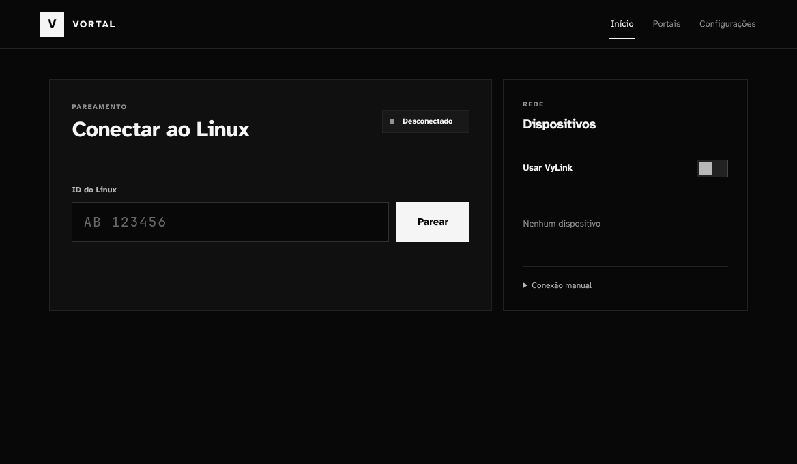
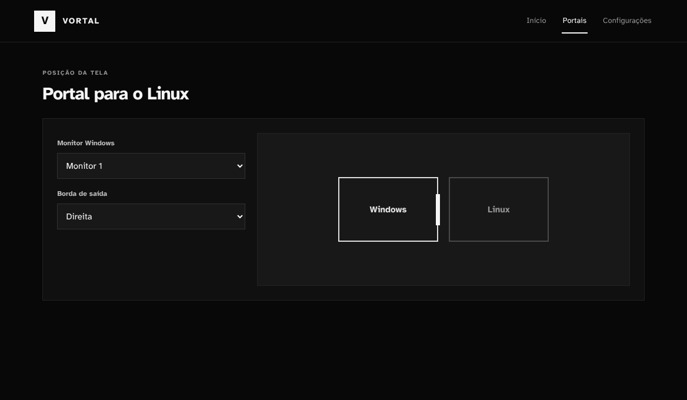
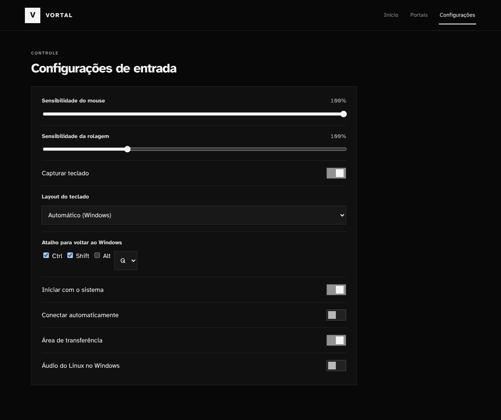

# Hliðskjálf · ᚼᛚᛁᚦᛋᚴᛁᛅᛚᚠ

**Um mouse e um teclado para o Windows e o Linux.**

> Na mitologia nórdica, **Hliðskjálf** (*"torre do portão"* ou *"assento do portal"*) é o trono de Odin, de onde ele enxerga todos os mundos. Daqui você controla todas as suas telas. Pronuncia-se **"HLÍDH-skiálv"**.

O Hliðskjálf liga os computadores pela rede. Arraste o cursor pela borda escolhida para controlar o outro computador; para voltar, cruze a borda de retorno ou use o atalho configurado. A conexão é aprovada pelo ID mostrado no computador controlado, sem precisar copiar certificados à mão.



*Prévia da interface Windows com dados de exemplo.*

## O que ele faz

- **Portais:** escolha o monitor e a borda por onde o cursor entra no Linux.
- **Pareamento por ID:** digite o ID do Linux no Windows e aprove o pedido no outro computador.
- **Área de transferência:** compartilhe texto e copie imagens do Windows para o Linux.
- **Áudio:** ouça no Windows o som reproduzido no Linux.
- **Segundo plano:** feche a janela e continue conectado pelo ícone da bandeja. O Hliðskjálf também pode iniciar com o Windows.
- **Windows como receptor:** outro Windows ou o Linux pode controlar este PC pelo ID; ative em **Configurações**.
- **Linux controla o Windows:** no app Linux, pareie pelo ID do Windows, escolha o monitor e a borda e ative **Conectar pelo portal**.
- **Idioma automático:** a versão Windows usa português do Brasil quando esse é o idioma do sistema; nos demais casos, usa inglês.

### Portais

Escolha a borda do monitor Windows que leva ao Linux. A tela mostra a posição dos computadores antes de você atravessar.



### Configurações

Ajuste mouse, teclado, atalho de retorno, inicialização, área de transferência e áudio em um só lugar.



## Como começar

Você precisa de um **Windows x64** e de um **Linux com Wayland** na mesma rede. O receptor Linux foi testado no **Hyprland**. O pareamento por ID descobre o Linux na rede local; Tailscale é opcional para computadores em redes diferentes.

1. **No Linux:** instale o Hliðskjálf com `./scripts/install.sh`, abra o app e copie o ID mostrado em **Configurações**.
2. **No Windows:** instale e abra o Hliðskjálf. Digite o ID do Linux e clique em **Parear**.
3. **No Linux:** confira o pedido e clique em **Permitir**. Depois, no Windows, abra **Portais** e escolha o monitor e a borda.

Baixe o instalador Windows (`Hlidskjalf-Setup-<versão>-x64.exe`) e o pacote Linux (`hlidskjalf-<versão>-linux-x86_64.tar.gz`) em [Releases](https://github.com/Vicente-PIlonetto/Hlidskjalf/releases). No Linux, extraia o pacote e rode `./scripts/install.sh`. Para gerar a partir do código, use `scripts\build-windows.bat` no Windows (requer Rust, Visual Studio C++ Build Tools e NSIS) ou `./scripts/install.sh` no Linux (requer Rust e as bibliotecas GTK de desenvolvimento). Veja o [guia de instalação](installers/windows/README.md) para os requisitos completos e o pareamento manual.

## Estado do projeto

O Hliðskjálf está em desenvolvimento. O fluxo principal é **Windows → Linux/Wayland**. A integração com Hyprland é a mais testada; outros ambientes Wayland podem exigir ajustes. O pareamento por ID evita a troca manual de arquivos na configuração comum. VyLink é opcional para quem usa essa rede.

O Hliðskjálf é feito em Rust. A janela e o controle de mouse e teclado funcionam separadamente, para que uma falha da interface não prenda o controle local.

<details>
<summary>Desenvolvimento</summary>

```sh
cargo fmt --all -- --check
cargo clippy --workspace --all-targets -- -D warnings
cargo test --workspace
```

Mais detalhes em [CONTRIBUTING.md](CONTRIBUTING.md) e na [arquitetura](docs/architecture.md).

</details>

## Nome

O projeto se chamava **Vortal**. Ao instalar esta versão, a identidade, os pareamentos e as configurações da versão anterior são migrados automaticamente; computadores com versões diferentes precisam ser atualizados juntos para se encontrarem pelo ID.

| Forma | Escrita |
|---|---|
| Nórdico antigo | Hliðskjálf |
| Futhark Novo | ᚼᛚᛁᚦᛋᚴᛁᛅᛚᚠ |
| Sem acentos (código e arquivos) | `hlidskjalf` |

## Licença

Apache-2.0 ou MIT, à sua escolha. Consulte [LICENSE-APACHE](LICENSE-APACHE) e [LICENSE-MIT](LICENSE-MIT).
